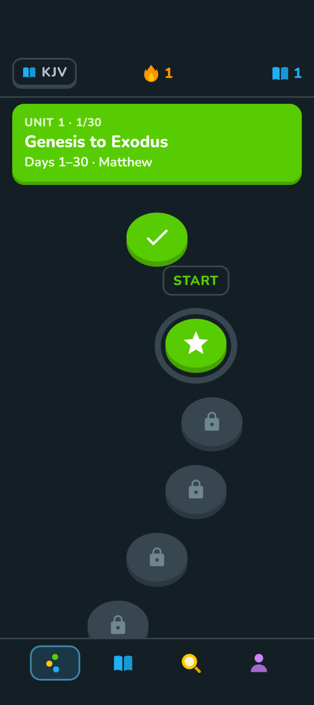
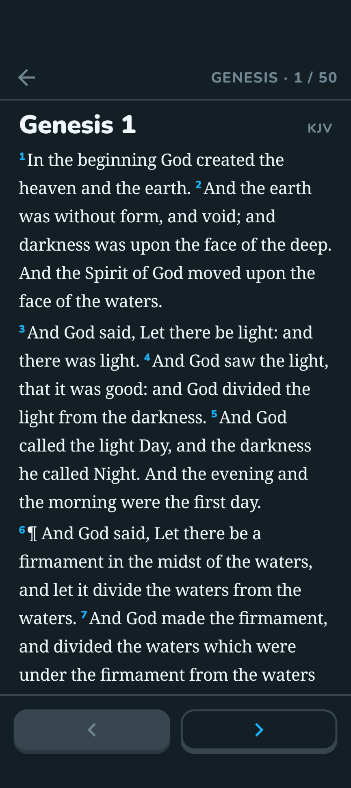
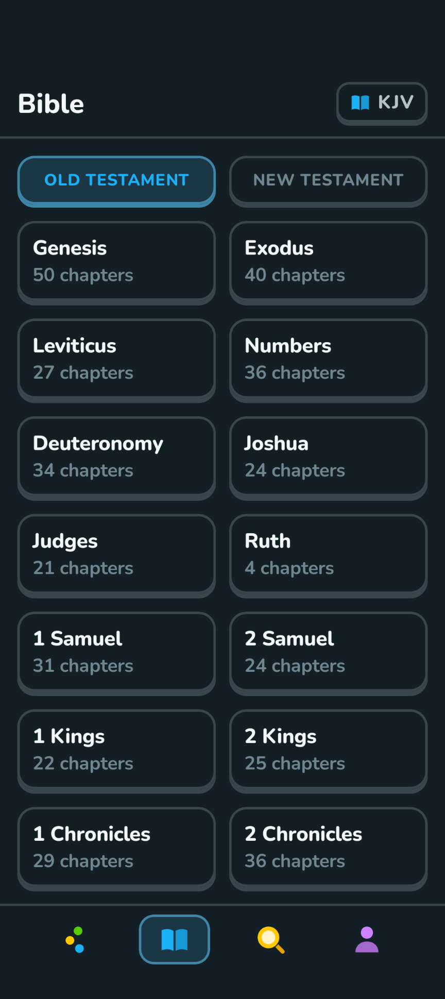
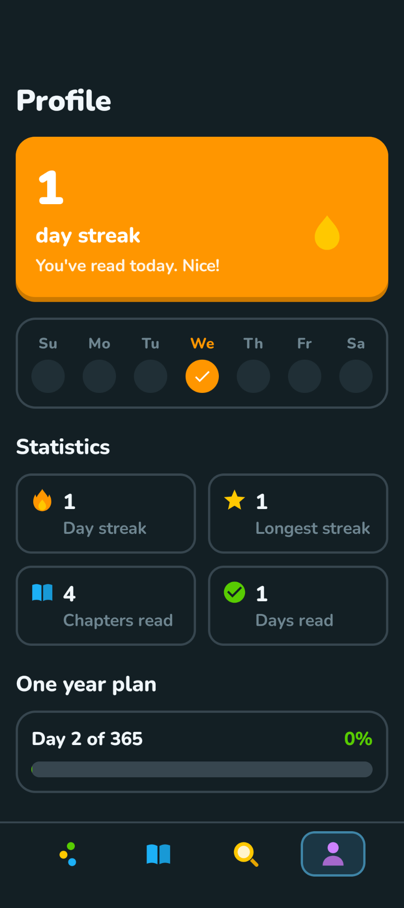

# Bible

A playful Android Bible app built around a **one-year reading plan** and **daily streak**..

<p align="center">
  
  
  
  
</p>

## Download

Grab the APK from the [latest release](../../releases/latest) and open it on your Android phone (Android 7.0 or newer, 64-bit ARM, which is every current phone). You may need to allow installing apps from your browser or file manager.

## Features

- **One-year reading plan**: all 1,189 chapters in 365 days. Every day has an Old Testament reading, plus New Testament and Psalms/Proverbs portions spread across the year, balanced by word count so each day takes about the same time. Days are grouped into 12 colour-coded units along a winding path.
- **Streaks**: read any day's portion to keep your streak alive. Includes a week view, your longest streak, and a celebration screen when you extend it.
- **Five built-in translations**, all public domain and fully offline: Berean Standard Bible (BSB), World English Bible (WEB), King James Version (KJV), American Standard Version (ASV) and Young's Literal Translation (YLT).
- **Import your own translations** from Zefania XML, OSIS XML, JSON or CSV/TSV files (also inside `.zip` or `.gz`). The format is detected automatically, with a preview and warnings before saving.
- **Search** across the whole Bible with word-start matching, exact-phrase results first, Old/New Testament filters, and jump-to-reference ("John 3:16", "ps 23", "1 cor 13").
- **Distraction-free reading**: the app and system bars slide away as you scroll, and come back when you scroll up, tap, or reach the end of the chapter.
- **Read aloud**: a speaker button in the reader reads the chapter verse by verse, highlighting and following along as it goes, and carries on into the next chapters. It keeps playing with the screen locked, with play/pause/skip controls on the lock screen, and pauses for calls or unplugged headphones. Choose the reading speed, and optionally play intro music as each chapter starts.
- **Natural voices**: uses your phone's own voice by default, or add more lifelike on-device voices by importing a [sherpa-onnx](https://k2-fsa.github.io/sherpa/onnx/tts/all/English/index.html) voice package (Piper, Kokoro or Kitten) from a file or a link. Everything runs offline on the phone.
- **Highlights and notes**: long-press a verse to highlight it in one of five colours, add a note, copy it, or start reading aloud from there. Notes show under their paragraph and appear in every translation.
- **Continue where you left off** (optional): the Bible tab reopens the last chapter you read.
- **Daily reminder** at a time you choose. It only notifies you if you haven't read yet, mentions your streak and today's readings, and opens straight into them.
- **Light, dark and pure-black themes**, adjustable text size, and a themed (Material You) app icon.

## Building

Requires Android Studio (or JDK 21) and the Android SDK.

```sh
./gradlew assembleDebug        # debug APK
./gradlew testDebugUnitTest    # unit, UI-behaviour and screenshot tests (Robolectric)
```

Release builds are signed with a key read from `keystore.properties` in the project root, which isn't in the repository:

```properties
storeFile=keystore/bible-release.jks
storePassword=...
keyAlias=bible
keyPassword=...
```

Without that file, `./gradlew assembleRelease` produces an unsigned APK.

The first build downloads the [sherpa-onnx](https://github.com/k2-fsa/sherpa-onnx) Android library (the on-device speech engine, ~39 MB) from its GitHub release into `app/libs/` and checks it against a pinned SHA-256. It isn't published to Maven, and it's kept out of git.

### Project layout

| Path | What's there |
|---|---|
| `app/src/main/java/.../data` | Bible text loading, reading plan, progress/streaks, search, translation import, reminders, read-aloud (narrator, voices, media service), highlights and notes |
| `app/src/main/java/.../ui` | Jetpack Compose screens, the "pop" button components and theme |
| `app/src/main/assets/bibles` | The built-in translations (gzipped, one line per verse/heading) |
| `app/src/main/assets/plan.txt` | The 365-day plan, one line per day |

## Credits and licenses

- **Code**: [GNU GPL v3.0](LICENSE).
- **Bible texts**: BSB, WEB, KJV, ASV and YLT are in the public domain. The texts were obtained from the [Free Use Bible API](https://bible.helloao.org).
- **Font**: [Nunito](https://github.com/googlefonts/nunito), under the [SIL Open Font License 1.1](licenses/Nunito-OFL.txt).
- **Speech engine**: [sherpa-onnx](https://github.com/k2-fsa/sherpa-onnx) (Apache 2.0), which bundles [ONNX Runtime](https://github.com/microsoft/onnxruntime) (MIT) and [espeak-ng](https://github.com/espeak-ng/espeak-ng) (GPL v3). [Apache Commons Compress](https://commons.apache.org/proper/commons-compress/) (Apache 2.0) unpacks voice packages.
- **Voices** aren't bundled: you download them yourself, and each has its own licence (for example, Kitten TTS is Apache 2.0, and Piper voices vary by voice).
- Imported translations stay on your device and are never uploaded or bundled with the app. Many modern translations are copyrighted, so check the licence of any file you import.
